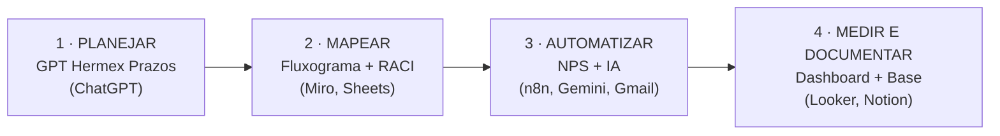

# Hermex Log — Projeto NPS

> Checkpoint **Nível 1** da carreira **Especialista em IA** (Alura): IA generativa, mapeamento de processos, automação no-code e dados aplicados a um problema real de negócio.



## 📌 O cenário

A **Hermex Log** (empresa de logística fictícia) está em transformação digital e tem três problemas:

1. **A comunicação entre vendas e pós-vendas falha**, e cada vendedor informa um prazo de entrega diferente.
2. **As reclamações não são tratadas de forma estruturada**, e não existe processo para coletar, classificar e analisar feedbacks.
3. **O atendimento perde tempo com perguntas repetitivas** (devolução, reembolso, prazos) que já estão documentadas, mas ninguém consulta.

## ❓ Perguntas que o projeto responde

| Etapa | Pergunta-chave |
|---|---|
| 1 | Como estruturar um assistente GPT reutilizável que padronize a comunicação de prazos, com certezas, suposições e dúvidas mapeadas? |
| 2 | Quais são os pontos críticos de comunicação entre equipes no pós-vendas e como a Matriz RACI ajuda a definir responsabilidades para automatizar? |
| 3 | Como construir um workflow que integre coleta de dados, regras de negócio e classificação por IA, com validação humana? |
| 4 | Como combinar dashboard (dados quantitativos) e base de conhecimento (dados semânticos) para apoiar decisões humanas e futuros agentes de IA? |

## 🛠️ Ferramentas

`ChatGPT (GPTs)` · `Miro` · `Google Sheets` · `Google Forms` · `n8n` · `Gemini API` · `Gmail` · `Looker Studio` · `Notion` · `Python` (validação e análise dos dados)

## 🔎 Principais insights

| Indicador | Valor |
|---|---|
| NPS geral | **−26,7%** (15 promotores × 31 detratores em 60 respostas) |
| NPS de São Paulo | **+92,3%** (12 dos 15 promotores da empresa) |
| NPS sem São Paulo | **−59,6%** |
| NPS de Norte e Nordeste | **−100%** em todos os estados |
| Principal motivo dos detratores | **Atraso: 67%** (18 de 27 com nota < 6), seguido de Defeito: 22% |

1. **O problema é de expectativa, não só de logística.** O Nordeste entrega em 6–9 dias úteis, **dentro do SLA** (6–12), e mesmo assim tem NPS −100%. Os clientes esperavam um prazo menor do que o oficial. Só 1 dos 60 pedidos estourou o SLA.
2. **Prazo e satisfação andam juntos.** Os 3 estados com NPS positivo (SP, SC, PR) entregam, em média, em até 5 dias corridos. Todos os estados com média de 8 dias ou mais têm NPS −100%.
3. **O atraso começa antes do transporte.** Norte e Nordeste levam 4 a 5,3 dias só para despachar o pedido, contra 2 dias em SP e no Sul.
4. **Metade dos pedidos não passou pelo handoff.** A pesquisa tem 60 pedidos e a planilha de handoff só 30, exatamente a falha de comunicação do cenário.

## ✅ Recomendações

1. **Padronizar a comunicação de prazo na venda** com o assistente *Hermex Prazos*, destacando o prazo máximo para Norte e Nordeste.
2. **Investigar a expedição** dos pedidos para Norte e Nordeste (4–5 dias até o envio) e a rota do RS (NPS −100%, destoando do restante do Sul).
3. **Automatizar o handoff** e o tratamento de detratores (n8n), com validação humana da classificação feita pela IA.
4. **Unificar a definição de detrator** (0–6, padrão NPS) entre a automação e o dashboard.
5. **Governar a base de conhecimento** (SLA revisado todo mês) antes de conectar um chatbot a ela.

---

## 🧩 A solução, etapa por etapa

### 1ª Etapa — Assistente GPT "Hermex Prazos"
[`etapa-1-assistente-gpt/`](etapa-1-assistente-gpt/)
- Planejamento (problema, critérios, formato de saída) e **Matriz CSD**
- Briefing com persona, **cadeia de pensamento em 5 etapas**, tabela de saída, cuidados e exemplos (*few-shot*)
- Configuração do GPT (pesquisa web e imagens desligadas, quebra-gelos) e roteiro de testes SP / BA / AM

### 2ª Etapa — Processo de pós-vendas e Matriz RACI
[`etapa-2-processo-raci/`](etapa-2-processo-raci/)
- Fluxograma com simbologia padrão, looping de entrega e 9 atividades candidatas à automação ([ver diagrama](etapa-2-processo-raci/fluxograma_posvendas.md))
- **Matriz RACI** com 13 atividades × 5 papéis (1 "A" por atividade, sistemas nunca são "A")
- Verificação da planilha de handoff e justificativa do handoff como ponto mais crítico (5 de 5 critérios)

### 3ª Etapa — Automação NPS com n8n e Gemini
[`etapa-3-automacao-n8n/`](etapa-3-automacao-n8n/)

```
Forms → Sheets Trigger → Buscar cliente → Organizar dados → IF nota < 6
                                                              ├─ true  → Gemini classifica → Extrair categoria → Gmail equipe
                                                              └─ false → Gmail agradecimento ao cliente
```
- Workflow importável: [`hermex_nps_automacao.json`](etapa-3-automacao-n8n/hermex_nps_automacao.json)
- Prompt com categorias definidas, regra de desempate e saída restrita a uma palavra (`temperature: 0`)
- E-mail para a equipe com o **comentário original para validação humana**
- [Gabarito](etapa-3-automacao-n8n/gabarito_classificacao.csv) com os 27 detratores, para medir a acurácia da IA

### 4ª Etapa — Dashboard no Looker Studio e base no Notion
[`etapa-4-dashboard-notion/`](etapa-4-dashboard-notion/)
- Campos calculados (Promotores, Detratores, NPS, dias até envio e até entrega) e 4 visualizações
- [Valores esperados](etapa-4-dashboard-notion/2_valores_esperados.txt), calculados de forma independente para validar o dashboard
- Base de conhecimento com 3 páginas escritas em parágrafos autossuficientes (prontas para vetorização)
- Documento de **governança de dados**

---

## 🧗 Desafios e como foram superados

| Desafio | Solução |
|---|---|
| O enunciado usa duas definições de detrator (`< 6` no n8n, `< 7` no Looker) | Segui o enunciado em cada etapa e documentei o impacto: 4 clientes com nota 6, incluindo uma reclamação de embalagem que não chega à equipe |
| Prazos diferentes entre etapas (SP 2–4 × Sudeste 2–5) | Uma tabela oficial única para o GPT e o Notion, com SP como exceção |
| O Forms só tem ID, nota e comentário, mas o e-mail precisa do nome | Nó de busca na base pelo `id_pedido` (o dado fica em um lugar só) |
| O Gemini pode responder fora do padrão | Nó de pós-processamento que garante uma das 5 categorias (testado com respostas simuladas) |
| O Looker não reconhece a sigla "SP" como estado | Campo `CONCAT("BR-", estado)` no padrão ISO 3166-2 |
| Dias úteis (SLA) × dias corridos (`DATE_DIFF`) | Documentado. A análise em dias úteis mostrou que só 1 pedido estourou o SLA |
| Os e-mails do dataset usam um domínio real (`email.com`) | Testes só com TempEmail, para não enviar mensagens a terceiros |

## 📄 Documentação completa

- **[RELATORIO_DO_PROJETO.md](RELATORIO_DO_PROJETO.md)**: o projeto inteiro explicado, incluindo o dicionário de dados, cada etapa, cada visualização do dashboard com seus dados, os insights, as recomendações e as limitações
- **[ENTREGA.md](ENTREGA.md)**: índice que liga cada missão do enunciado ao arquivo que a atende

## ▶️ Como reproduzir

| Etapa | O que fazer |
|---|---|
| Dados | Importe os CSVs de [`dados/`](dados/) no Google Sheets. Antes, mude a localidade da planilha para "Estados Unidos", para que o ponto decimal seja lido corretamente |
| 1 · GPT | No ChatGPT, crie um GPT seguindo [`3_configuracao_gpt.txt`](etapa-1-assistente-gpt/3_configuracao_gpt.txt) e cole o [briefing](etapa-1-assistente-gpt/2_briefing_hermex_prazos.txt) em "Instruções" |
| 2 · RACI | Importe [`matriz_raci.csv`](etapa-2-processo-raci/matriz_raci.csv) numa aba "Matriz RACI" e desenhe o fluxograma no Miro a partir da [especificação](etapa-2-processo-raci/1_fluxograma_posvendas.txt) |
| 3 · n8n | No n8n: *Import from File* → [`hermex_nps_automacao.json`](etapa-3-automacao-n8n/hermex_nps_automacao.json). Configure as credenciais (Google, Gemini, Gmail) conforme o [guia](etapa-3-automacao-n8n/4_importar_e_configurar_n8n.txt) |
| 4 · Dashboard | No Looker Studio, siga o [passo a passo](etapa-4-dashboard-notion/1_looker_studio_passo_a_passo.txt) e confira o resultado com os [valores esperados](etapa-4-dashboard-notion/2_valores_esperados.txt) |
| 4 · Notion | Crie o database "Processos Hermex Log" e cole as páginas de [`3_notion_base_conhecimento.md`](etapa-4-dashboard-notion/3_notion_base_conhecimento.md) |

> ⚠️ Os e-mails do dataset usam o domínio `email.com`, que existe de verdade. Para testar o workflow, troque-os por endereços temporários (ex.: TempEmail).

## 📁 Estrutura

```
RELATORIO_DO_PROJETO.md     relatório completo do projeto
ENTREGA.md                  índice da entrega (missão → arquivo)
dados/                      datasets originais + dataset enriquecido + indicadores do dashboard
etapa-1-assistente-gpt/     planejamento, Matriz CSD, briefing, configuração e testes do GPT
etapa-2-processo-raci/      fluxograma (spec + Mermaid), Matriz RACI, verificação do handoff, justificativa
etapa-3-automacao-n8n/      Forms, prompt, e-mails, workflow n8n (JSON), guia, testes e gabarito
etapa-4-dashboard-notion/   guia do Looker, valores esperados, páginas do Notion, governança
```

## 📜 Licença

[MIT](LICENSE). Os dados são fictícios e foram fornecidos pela Alura para fins educacionais.
