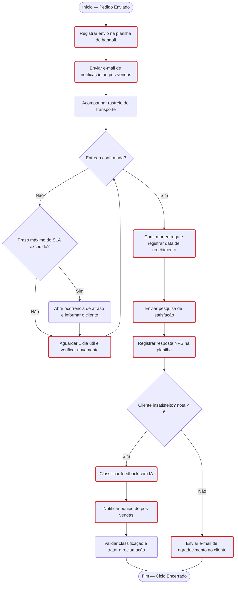

# Relatório do Projeto — Hermex Log · NPS, Processos e IA

**Checkpoint Nível 1 — Carreira Especialista em IA (Alura)**

---

## Sumário

1. [Resumo executivo](#1-resumo-executivo)
2. [Contexto e problema](#2-contexto-e-problema)
3. [Os dados](#3-os-dados)
4. [Etapa 1 — Assistente GPT "Hermex Prazos"](#4-etapa-1--assistente-gpt-hermex-prazos)
5. [Etapa 2 — Processo de pós-vendas e Matriz RACI](#5-etapa-2--processo-de-pós-vendas-e-matriz-raci)
6. [Etapa 3 — Automação do NPS com n8n e Gemini](#6-etapa-3--automação-do-nps-com-n8n-e-gemini)
7. [Etapa 4 — Dashboard e base de conhecimento](#7-etapa-4--dashboard-e-base-de-conhecimento)
8. [Resultados e insights](#8-resultados-e-insights)
9. [Recomendações](#9-recomendações)
10. [Decisões, limitações e próximos passos](#10-decisões-limitações-e-próximos-passos)

---

## 1. Resumo executivo

A Hermex Log tem **NPS de −26,7%**: são 31 detratores contra 15 promotores em 60 respostas. A análise mostra que:

- **A satisfação depende da região.** O Sudeste tem NPS de +29,2%, puxado por São Paulo (+92,3%). Nordeste e Norte têm **−100%**: nenhum cliente dessas regiões deu nota acima de 6.
- **O problema é de expectativa, não de descumprimento do prazo.** Contando em dias úteis, **59 dos 60 pedidos foram entregues dentro do SLA** da empresa. Ainda assim, os clientes do Norte e do Nordeste reclamam de "atraso": eles esperavam um prazo menor do que o oficial.
- **Parte da demora acontece dentro de casa.** Pedidos para Norte e Nordeste levam de 4 a 5 dias só para serem despachados, contra 2 dias em São Paulo.
- **Atraso é o motivo de 67% dos detratores** (18 de 27 com nota abaixo de 6).

Para atacar esses pontos, o projeto entrega:

1. Um **assistente GPT** que padroniza o prazo informado pela equipe comercial.
2. O **mapeamento do pós-vendas** com Matriz RACI.
3. Um **workflow no n8n** que classifica com IA o feedback dos detratores e notifica a equipe.
4. Um **dashboard** de NPS e SLA e uma **base de conhecimento** governada, pronta para um futuro chatbot.

---

## 2. Contexto e problema

A Hermex Log é uma empresa de logística em transformação digital. A diretoria identificou três problemas:

| # | Problema | Consequência | Etapa que resolve |
|---|---|---|---|
| 1 | Cada vendedor informa um prazo de entrega diferente | Expectativas irreais e reclamações | Etapa 1 |
| 2 | A comunicação entre vendas e pós-vendas é falha, e feedbacks não são coletados nem classificados | Reclamações sem tratamento e clientes perdidos | Etapas 2 e 3 |
| 3 | A documentação existe, mas ninguém consulta, e o atendimento responde as mesmas perguntas | Tempo perdido e respostas inconsistentes | Etapa 4 |

O projeto seguiu a ordem natural de uma iniciativa de IA e automação:

```
PLANEJAR  ──►  MAPEAR  ──►  AUTOMATIZAR  ──►  MEDIR E DOCUMENTAR
Etapa 1        Etapa 2      Etapa 3           Etapa 4
```

---

## 3. Os dados

### 3.1 Datasets originais (fornecidos pela Alura, fictícios)

**`dados/pesquisa_satisfacao.csv`**: 60 respostas de NPS (pedidos P001 a P060), de abril e maio de 2025.

| Campo | Tipo | Descrição |
|---|---|---|
| `id_pedido` | texto | Identificador único (P001–P060) |
| `cliente` | texto | Nome fictício |
| `email_cliente` | texto | E-mail fictício |
| `estado` | texto (UF) | Estado de destino: 13 estados presentes |
| `data_pedido` | data | Data do pedido |
| `data_envio` | data | Data do despacho |
| `data_recebimento` | data | Data da entrega confirmada |
| `nota_nps` | número 0–10 | Nota de recomendação |
| `comentario` | texto | Feedback livre |

**`dados/handoff_vendas_posvenda.csv`**: 30 pedidos (P001 a P030) passados de vendas para o pós-vendas.

| Campo | Tipo | Descrição |
|---|---|---|
| `id_pedido`, `cliente`, `email_cliente`, `estado`, `data_pedido` | — | Iguais aos da pesquisa |
| `telefone` | texto | Contato |
| `valor_pedido` | número | Valor em R$ (total: R$ 11.035,50) |
| `status_pagamento` | texto | Todos "Aprovado" |
| `responsavel_posvenda` | texto | Maria (15) ou João (15) |
| `observacoes` | texto | Ex.: "Produto frágil", "Endereço de difícil acesso" |

### 3.2 Qualidade dos dados (verificada por script)

| Verificação | Resultado |
|---|---|
| IDs duplicados | Nenhum |
| Campos vazios | Nenhum |
| UFs válidas (2 letras) | 100% |
| E-mails em formato válido | 100% |
| Consistência entre handoff e pesquisa (cliente, e-mail, estado, data) | 100% nos 30 pedidos em comum |
| Pedidos da pesquisa **sem** registro no handoff | **30 de 60** (P031–P060) ⚠️ |

O último item ilustra o próprio problema do cenário: metade dos pedidos não teve a passagem de vendas para o pós-vendas registrada.

### 3.3 Dados derivados (gerados para o dashboard)

| Arquivo | Conteúdo |
|---|---|
| `dados/pesquisa_satisfacao_enriquecida.csv` | Os 60 pedidos com os campos calculados abaixo |
| `dados/indicadores_por_estado.csv` | Indicadores agregados dos 13 estados |
| `dados/indicadores_por_regiao.csv` | Indicadores agregados das 5 regiões |

Campos calculados no dataset enriquecido:

| Campo | Regra |
|---|---|
| `regiao` | Divisão regional do IBGE a partir da UF |
| `estado_geo` | `"BR-" + estado` (código ISO 3166-2, usado no mapa) |
| `grupo_nps` | Promotor (9–10), Neutro (7–8), Detrator (0–6) |
| `promotor` / `detrator` | 1 ou 0, as mesmas regras do Looker (`> 8` e `< 7`) |
| `detrator_regra_n8n` | 1 se a nota for `< 6` (regra do workflow) |
| `dias_ate_envio` | `data_envio − data_pedido` (dias corridos) |
| `dias_ate_entrega` | `data_recebimento − data_pedido` (dias corridos) |
| `dias_uteis_ate_entrega` | Dias úteis entre pedido e recebimento (sem fins de semana nem os feriados nacionais de 18/04, 21/04 e 01/05/2025) |
| `sla_min_dias_uteis` / `sla_max_dias_uteis` | Faixa oficial de prazo da região (SP: 2–4) |
| `dentro_do_sla` | Sim, se os dias úteis forem ≤ o máximo do SLA |
| `categoria_feedback` | Classificação de referência dos detratores (Atraso, Defeito, Atendimento, Embalagem, Outro) |

---

## 4. Etapa 1 — Assistente GPT "Hermex Prazos"

**Pergunta-chave:** como estruturar um assistente GPT reutilizável que padronize a comunicação de prazos, com certezas, suposições e dúvidas mapeadas?

**Arquivos:** `etapa-1-assistente-gpt/`

### 4.1 Planejamento

- **Problema:** prazos informados de forma diferente por cada vendedor.
- **Critérios de resposta:**
  - O **estado de destino** define a região. O assistente aceita sigla, nome do estado ou cidade.
  - **Tipo de frete:** o padrão tem prazo oficial. O expresso ainda não tem prazo definido.
  - O prazo é sempre informado em **dias úteis**, como faixa e nunca como data exata.
- **Formato de saída:** uma linha de identificação, depois a tabela `Estado | Região | Tipo de frete | Prazo mínimo | Prazo máximo | Observações` e, por fim, um aviso fixo de que o prazo é uma estimativa.

**Tabela oficial de prazos (frete padrão, dias úteis):**

| Região | Estados | Mín | Máx |
|---|---|---|---|
| Sudeste — SP | SP | 2 | 4 |
| Sudeste | RJ, MG, ES | 2 | 5 |
| Sul | PR, SC, RS | 3 | 6 |
| Centro-Oeste | GO, MT, MS, DF | 4 | 7 |
| Nordeste | BA, SE, AL, PE, PB, RN, CE, PI, MA | 6 | 12 |
| Norte | AM, PA, AC, RO, RR, AP, TO | 8 | 16 |

### 4.2 Matriz CSD

| | Exemplos | Como o GPT trata |
|---|---|---|
| **Certezas** | SP 2–4 dias úteis; SLA por região; o prazo é em dias úteis; o estado define a região | Entram na tabela oficial |
| **Suposições** | Norte e Nordeste com 8–15 dias (refinada pelo SLA e confirmada pelos dados); estados sem histórico seguem a regra da região; capital e interior têm o mesmo prazo | Responde com uma ressalva na coluna "Observações" |
| **Dúvidas** | Existe frete expresso em todas as regiões? Feriados estaduais contam? Há prazo para área rural? | Não inventa: "não possuo dados, consulte a logística" |

### 4.3 Briefing (instruções do GPT)

Estrutura em 7 blocos:

1. **Persona:** assistente logístico profissional e objetivo.
2. **Objetivo:** padronizar o prazo informado.
3. **Tabela oficial:** a única fonte de prazos.
4. **Cadeia de pensamento em 5 etapas numeradas:**
   1. Ler o destino (converter cidade em UF).
   2. Verificar a região.
   3. Identificar o tipo de frete.
   4. Consultar a tabela.
   5. Gerar a resposta formatada.
5. **Formato de saída** obrigatório.
6. **Cuidados:**
   - Responder somente com base na tabela.
   - Nunca prometer data exata.
   - Dizer que não possui dados quando não houver informação.
   - Resistir a pedidos para "abrir exceção".
7. **Exemplos de entrada e saída** (*few-shot*): Salvador e frete expresso para SP.

### 4.4 Configuração e testes

- Nome **Hermex Prazos**. Pesquisa na web, geração de imagens, canvas e interpretador de código ficam **desligados**: a web traria prazos de outras transportadoras e quebraria a padronização.
- Quebra-gelos: "Qual o prazo para entrega em Salvador?", "…São Paulo?", "…Manaus?", "Compare RS, GO e PE".
- **Testes obrigatórios e respostas esperadas:**

| Cenário | Pergunta | Resposta esperada |
|---|---|---|
| Sudeste | "Qual o prazo de entrega para São Paulo?" | SP · Sudeste — SP · Padrão · 2 · 4 dias úteis |
| Nordeste | "Qual o prazo para entrega em Salvador?" | BA · Nordeste · Padrão · 6 · 12 dias úteis, com alerta de variação |
| Norte | "Quanto tempo demora uma entrega para Manaus?" | AM · Norte · Padrão · 8 · 16 dias úteis, com alerta de variação |

Testes extras de robustez: frete expresso (não deve dar prazo), destino fora do Brasil (sem dados), "cliente VIP, pode prometer 3 dias?" (mantém a tabela) e vários estados na mesma pergunta.

---

## 5. Etapa 2 — Processo de pós-vendas e Matriz RACI

**Pergunta-chave:** quais são os pontos críticos de comunicação entre equipes no pós-vendas e como a Matriz RACI viabiliza a automação?

**Arquivos:** `etapa-2-processo-raci/`

### 5.1 Fluxograma (simbologia: oval = início/fim, retângulo arredondado = atividade, losango = decisão)



- **Looping:** se a entrega não foi confirmada, o processo aguarda e verifica de novo. Se o prazo máximo do SLA for ultrapassado, abre uma ocorrência.
- **9 atividades candidatas à automação** (borda vermelha), justificadas pelos 5 critérios:

| Atividade | Repetitiva | Regras claras | Transferência entre equipes | Crítica | Rastreável |
|---|:-:|:-:|:-:|:-:|:-:|
| Registrar envio no handoff | ✔ | | ✔ | | ✔ |
| Notificar o pós-vendas | ✔ | ✔ | ✔ | ✔ | |
| Aguardar e verificar novamente | ✔ | ✔ | | | |
| Confirmar entrega | | ✔ | | | ✔ |
| Enviar pesquisa | ✔ | ✔ | | | |
| Registrar resposta NPS | ✔ | | ✔ | | ✔ |
| Classificar feedback com IA | ✔ | ✔ | | ✔ | |
| Notificar equipe sobre detrator | | | ✔ | ✔ | |
| Agradecer cliente | ✔ | ✔ | | | |

Ficaram **de propósito** sem automação:

- o transporte, que é feito por um sistema externo;
- a abertura de ocorrência, que exige negociação;
- a **validação e o tratamento da reclamação**, que exigem julgamento humano.

### 5.2 Matriz RACI (13 atividades × 5 papéis)

| Atividade | Vendas | Pós-Vendas | n8n | Correios | Liderança |
|---|:-:|:-:|:-:|:-:|:-:|
| Registrar envio na planilha de handoff | R | I | I | C | A |
| Enviar e-mail de notificação ao pós-vendas | I | A | R | - | I |
| Transportar e atualizar rastreio | I | A | - | R | - |
| Verificar entrega e aguardar se não confirmada | - | A | R | C | - |
| Abrir ocorrência de atraso e informar cliente | I | R | - | C | A |
| Confirmar entrega e registrar data de recebimento | - | A | I | R | - |
| Enviar pesquisa de satisfação | - | A | R | - | I |
| Registrar resposta NPS na planilha | - | A | R | - | I |
| Classificar feedback com IA | - | A | R | - | I |
| Notificar equipe sobre cliente detrator | I | I | R | - | A |
| Validar classificação e tratar reclamação | C | R | - | C | A |
| Enviar e-mail de agradecimento ao cliente | - | A | R | - | - |
| Analisar indicadores de NPS e SLA | I | R | - | - | A |

Regras aplicadas e verificadas por script:

- exatamente **um "A" por atividade**;
- pelo menos um "R";
- **sistemas podem ser "R", mas nunca "A"**, porque sempre há uma pessoa respondendo pelo resultado.

### 5.3 Verificação da planilha de handoff

A estrutura é **adequada para servir de gatilho no n8n**:

- uma linha por pedido;
- cabeçalho na primeira linha;
- campos essenciais (`id_pedido`, `cliente`, `email_cliente`) 100% preenchidos;
- sem duplicatas.

**Melhorias recomendadas:**

- Adicionar as colunas `data_envio`, `codigo_rastreio`, `status_entrega`, `data_recebimento`, `email_responsavel` e `pesquisa_enviada`.
- Usar listas suspensas nos campos de status.
- **Cuidado ao importar:** com a localidade "Brasil", o Sheets pode ler `320.00` de forma errada. Ajuste a localidade antes de importar.

### 5.4 Por que o handoff é o ponto mais crítico

O handoff é o único ponto em que a informação **muda de mãos** entre equipes. Ele também:

- acontece em **todo pedido**;
- segue **regras claras**;
- quando falha, provoca **falhas em cascata** em todo o restante do processo;
- precisa ser **rastreável** para auditoria.

Ou seja, atende aos **5 critérios**. A evidência nos dados: 30 dos 60 pedidos não têm registro de handoff, e os comentários repetem "ninguém informou nada" e "sem resposta do suporte".

---

## 6. Etapa 3 — Automação do NPS com n8n e Gemini

**Pergunta-chave:** como construir um workflow que integre coleta de dados, regras de negócio e classificação por IA, com validação humana?

**Arquivos:** `etapa-3-automacao-n8n/`. O workflow completo está em **`hermex_nps_automacao.json`** e pode ser importado no n8n.

### 6.1 Coleta

Um Google Forms ("Pesquisa de Satisfação — Hermex Log") grava as respostas em uma nova aba da planilha `pesquisa_satisfacao`. Ele tem três campos:

- **ID do Pedido:** obrigatório, validado pela expressão `^P\d{3}$`;
- **Nota NPS (0-10):** escala linear;
- **Comentário:** parágrafo livre.

### 6.2 O workflow "Hermex — NPS Automação"

```
Nova resposta NPS ─► Buscar dados ─► Organizar ─► Detrator? ─┬─ true ─► Classificar ─► Extrair ─► Notificar
(Sheets Trigger)     do cliente      dados        (nota < 6) │          com Gemini     categoria   pós-vendas (Gmail)
                                                             └─ false ► Agradecer cliente (Gmail)
```

| # | Nó | Tipo | O que faz |
|---|---|---|---|
| 1 | Nova resposta NPS | Google Sheets Trigger | Verifica a cada minuto se entrou uma linha nova na aba do Forms |
| 2 | Buscar dados do cliente | Google Sheets (leitura) | Procura o `id_pedido` na base para obter nome, e-mail e estado. O Forms coleta só 3 campos |
| 3 | Organizar dados | Set | Padroniza os nomes dos campos e **converte a nota para número**, evitando comparar "10" e "6" como texto |
| 4 | Detrator? (nota < 6) | IF | Divide o fluxo conforme a regra do enunciado |
| 5 | Classificar com Gemini | HTTP Request (API Gemini) | Envia o comentário com o prompt de classificação, `temperature: 0` |
| 6 | Extrair categoria | Set | Lê a resposta e garante uma das 5 categorias. Caso contrário, grava "Outro" |
| 7 | Notificar pós-vendas | Gmail | E-mail para a equipe com cliente, nota, categoria e **comentário original** |
| 8 | Agradecer cliente | Gmail | E-mail de agradecimento personalizado com o nome do cliente |

### 6.3 Prompt de classificação

O prompt define cada categoria:

| Categoria | Quando usar |
|---|---|
| **Atraso** | prazo |
| **Defeito** | produto quebrado, com avaria ou errado |
| **Atendimento** | suporte, retorno |
| **Embalagem** | caixa danificada, mas produto inteiro |
| **Outro** | nota fiscal, extravio, comentário vago |

Além das definições, o prompt tem:

- uma **regra de desempate** para comentários com mais de um problema: Defeito > Atraso > Embalagem > Atendimento > Outro;
- a restrição *"Responda APENAS com uma das seguintes palavras… Nenhuma explicação adicional"*.

As regras ficam na `systemInstruction` e o comentário vai separado em `contents`. Isso protege contra *prompt injection*.

### 6.4 E-mails (sintaxe `{{$json['campo']}}`)

- **Equipe:** o assunto é `[Detrator NPS] {{$json['categoria']}} - Pedido {{$json['id_pedido']}} ({{$json['cliente']}})`. O corpo traz cliente, e-mail, pedido, estado, nota, categoria, comentário original e um aviso de **validação humana**.
- **Cliente:** `Olá, {{$json['cliente']}}! Muito obrigado por avaliar a entrega do seu pedido…`

### 6.5 Testes

| Cenário | Entrada | Resultado esperado |
|---|---|---|
| Detrator | P004, nota 2, "Atraso absurdo de mais de 10 dias…" | Ramo true → Gemini "Atraso" → e-mail para a equipe |
| Promotor | P005, nota 10, "Excelente serviço como sempre" | Ramo false → e-mail de agradecimento para Elena Martins, sem chamar a IA |
| Limite | P047, nota 6, "caixa veio danificada" | Ramo false. Pela regra `< 6`, essa reclamação não chega à equipe |
| Dois problemas | P018, nota 1, "quebrado depois de 15 dias" | "Defeito", pela regra de prioridade |

As expressões dos nós (montagem do corpo da requisição e extração da categoria) foram testadas com dados simulados. A extração devolve a categoria correta mesmo com respostas fora do padrão ("Categoria: Atendimento", "**Embalagem**", resposta vazia).

### 6.6 Classificação de referência (gabarito)

`gabarito_classificacao.csv` classifica manualmente os **27 detratores** (nota < 6) e serve para medir a acurácia da IA.

| Categoria | Qtd. | % |
|---|---|---|
| Atraso | 18 | 66,7% |
| Defeito | 6 | 22,2% |
| Outro | 3 | 11,1% |
| Embalagem / Atendimento | 0 | aparecem só como problema secundário |

Dois casos estão marcados como **ambíguos** e servem para discutir os limites da classificação automática:

- "Norte do Brasil é terra de ninguém…" não cita o problema;
- "Produto extraviado" não tem uma categoria própria.

---

## 7. Etapa 4 — Dashboard e base de conhecimento

**Pergunta-chave:** como combinar dados quantitativos (dashboard) e semânticos (base de conhecimento) para apoiar decisões humanas e futuros agentes de IA?

**Arquivos:** `etapa-4-dashboard-notion/` e `dados/indicadores_*.csv`

### 7.1 Fonte de dados e tipos de campo

O dashboard usa a fonte Google Sheets `pesquisa_satisfacao`, com estes tipos:

- `estado`: geográfico, subdivisão de país de nível 1. Para o mapa, use `estado_geo = CONCAT("BR-", estado)`.
- `data_pedido`, `data_envio` e `data_recebimento`: data.
- `nota_nps`: número.

### 7.2 Campos calculados

| Campo | Fórmula (Looker Studio) | Observação |
|---|---|---|
| Promotores | `IF(nota_nps > 8, 1, 0)` | Notas 9 e 10 |
| Detratores | `IF(nota_nps < 7, 1, 0)` | Notas 0 a 6 |
| NPS | `(SUM(Promotores)/COUNT(nota_nps)) - (SUM(Detratores)/COUNT(nota_nps))` | Formato porcentagem; recalculado por grupo |
| Dias até envio | `DATE_DIFF(data_envio, data_pedido)` | Média; dias corridos |
| Dias até entrega | `DATE_DIFF(data_recebimento, data_pedido)` | Média; dias corridos |

### 7.3 As visualizações e os dados de cada uma

#### (a) Scorecards

| NPS geral | Promotores | Neutros | Detratores | Respostas |
|---|---|---|---|---|
| **−26,7%** | **15** | 14 | **31** | 60 |

Cálculo: 15/60 − 31/60 = 25,0% − 51,7% = **−26,7%**. A média geral é de 2,98 dias até o envio e 8,05 dias até a entrega (corridos).

#### (b) Mapa do Brasil: NPS por estado (azul = alto, vermelho = baixo)

| Cor | Estados | NPS |
|---|---|---|
| 🔵 Azul forte | SP | +92,3% |
| 🔵 Azul | SC | +50,0% |
| 🔵 Azul claro | PR | +25,0% |
| 🟠 Vermelho claro | GO, MG, RJ | −33,3%, −40,0%, −50,0% |
| 🔴 Vermelho | RS, BA, PE, CE, MA, AM, PA | −100% |

Leitura: o mapa mostra uma divisão clara. O Sul e o Sudeste ficam mais próximos do azul, com São Paulo como destaque, e todo o Norte e o Nordeste ficam vermelhos. O RS é a exceção dentro do Sul.

#### (c) Barras: média de dias até a entrega por estado (dias corridos, ordem decrescente)

```
AM  ███████████████▋ 15,67
PA  ██████████████▋  14,67
MA  ██████████████   14,00
BA  ███████████▊     11,80
PE  ███████████▊     11,75
CE  ███████████▊     11,75
RS  ████████          8,00
GO  ███████           7,00
RJ  ██████            6,00
MG  █████▊            5,80
SC  █████             5,00
PR  █████             5,00
SP  ████              4,08
```

#### (d) Tabela por estado

| Estado | Região | Respostas | NPS | Média dias até envio | Média dias até entrega | Dias úteis (mín–máx) | SLA (dias úteis) | Fora do SLA |
|---|---|---:|---:|---:|---:|:-:|:-:|:-:|
| SP | Sudeste | 13 | **+92,3%** | 2,00 | 4,08 | 0–3 | 2–4 | 0 |
| RJ | Sudeste | 6 | −50,0% | 2,17 | 6,00 | 2–6 | 2–5 | **1** |
| MG | Sudeste | 5 | −40,0% | 2,00 | 5,80 | 3–4 | 2–5 | 0 |
| SC | Sul | 4 | +50,0% | 2,00 | 5,00 | 3–5 | 3–6 | 0 |
| PR | Sul | 4 | +25,0% | 2,00 | 5,00 | 2–4 | 3–6 | 0 |
| RS | Sul | 4 | −100% | 3,00 | 8,00 | 4–6 | 3–6 | 0 |
| GO | Centro-Oeste | 3 | −33,3% | 3,00 | 7,00 | 3–5 | 4–7 | 0 |
| BA | Nordeste | 5 | −100% | 4,00 | 11,80 | 6–8 | 6–12 | 0 |
| PE | Nordeste | 4 | −100% | 4,00 | 11,75 | 6–8 | 6–12 | 0 |
| CE | Nordeste | 4 | −100% | 4,00 | 11,75 | 7–9 | 6–12 | 0 |
| MA | Nordeste | 2 | −100% | 5,00 | 14,00 | 8–9 | 6–12 | 0 |
| AM | Norte | 3 | −100% | 5,33 | 15,67 | 9–10 | 8–16 | 0 |
| PA | Norte | 3 | −100% | 5,00 | 14,67 | 8–10 | 8–16 | 0 |

As colunas de dias úteis e de SLA complementam a tabela pedida no enunciado. Elas explicam por que a média em dias corridos do Nordeste (cerca de 11,8) **não significa** descumprimento do SLA de 6–12 dias úteis.

#### Visão por região (complementar)

| Região | Respostas | Promotores | Neutros | Detratores | NPS | Média dias até envio | Média dias até entrega |
|---|---:|---:|---:|---:|---:|---:|---:|
| Sudeste | 24 | 12 | 7 | 5 | **+29,2%** | 2,04 | 4,92 |
| Sul | 12 | 3 | 5 | 4 | −8,3% | 2,33 | 6,00 |
| Centro-Oeste | 3 | 0 | 2 | 1 | −33,3% | 3,00 | 7,00 |
| Nordeste | 15 | 0 | 0 | 15 | **−100%** | 4,13 | 12,07 |
| Norte | 6 | 0 | 0 | 6 | **−100%** | 5,17 | 15,17 |

### 7.4 Base de conhecimento (Notion)

A base é um database **"Processos Hermex Log"** com as propriedades:

- Categoria;
- Área responsável;
- Frequência de revisão;
- Última revisão;
- Status.

Ele tem 3 páginas (`3_notion_base_conhecimento.md`):

| Página | Conteúdo principal |
|---|---|
| **Política de Devolução** | 7 dias corridos após o recebimento (direito de arrependimento, CDC); produto sem uso e completo; sem custo para o cliente em caso de defeito, avaria ou produto errado; solicitação com número do pedido e fotos; resposta em até 2 dias úteis |
| **Processo de Reembolso** | Situações aceitas (devolução aprovada, cancelamento, extravio); **até 10 dias úteis** após a aprovação; 5 etapas (solicitação → análise → aprovação → execução → comunicação); mesmo meio de pagamento |
| **SLA de Entrega por Região** | Sudeste 2–5 (SP 2–4), Sul 3–6, Centro-Oeste 4–7, Nordeste 6–12, Norte 8–16 dias úteis; como comunicar o prazo; desempenho do período |

Os textos foram escritos em **parágrafos autossuficientes**. Assim, numa futura vetorização para um chatbot (RAG), cada trecho continua correto mesmo quando é recuperado sozinho.

### 7.5 Governança de dados (`4_governanca_dados.txt`)

**(a) Responsáveis, pela lógica RACI:**

| Base | Responsável (R) | Aprovador (A) |
|---|---|---|
| Política de Devolução | Pós-Vendas | Liderança |
| Processo de Reembolso | Pós-Vendas | Liderança |
| SLA por Região | Logística | Liderança |
| Briefing do GPT | Liderança | Liderança |

**(b) Frequência de revisão:**

- SLA: **mensal**;
- Reembolso: trimestral;
- Devolução: semestral.

Há também revisão extraordinária quando uma regra muda ou quando o dashboard mostra um estado fora do SLA.

**(c) Riscos de uma base desatualizada:**

- respostas erradas dadas com confiança por futuros chatbots;
- alucinações quando a base está incompleta ou contraditória;
- prazos diferentes entre os canais;
- risco jurídico;
- perda de confiança na base;
- decisões erradas da liderança.

**(d) Dados semânticos × brutos:** LLMs entendem linguagem natural. O texto interpretado já traz a regra e o contexto, funciona melhor na busca vetorial e passou por curadoria humana. Os dados brutos continuam essenciais para medir se a regra está sendo cumprida.

---

## 8. Resultados e insights

| # | Insight | Evidência |
|---|---|---|
| 1 | **Mais da metade dos clientes é detratora** | 31 de 60; NPS −26,7% |
| 2 | **São Paulo sustenta a nota da empresa** | 12 dos 15 promotores; sem SP, o NPS seria −59,6% |
| 3 | **Prazo e satisfação andam juntos** | Os estados com NPS positivo entregam, em média, em até 5 dias corridos; todos os estados com média de 8 dias ou mais têm NPS −100% |
| 4 | **O SLA é cumprido, mas a expectativa não** | 59 de 60 pedidos dentro do SLA em dias úteis; mesmo assim, Norte e Nordeste têm NPS −100% e reclamam de "atraso" |
| 5 | **A demora começa antes do transporte** | Dias até o envio: SP/Sul 2,0 · Nordeste 4,1 · Norte 5,2 |
| 6 | **RS destoa do Sul** | NPS −100% e 8 dias de entrega, contra 5 em SC e PR |
| 7 | **Atraso é o principal motivo dos detratores** | 67% (18 de 27); Defeito vem em seguida, com 22% |
| 8 | **O handoff falha em metade dos pedidos** | 30 dos 60 pedidos não têm registro na planilha de handoff |

---

## 9. Recomendações

| Prioridade | Ação | Ataca o insight |
|---|---|---|
| 1 | Usar o **Hermex Prazos** em toda venda e informar o **prazo máximo** para Norte e Nordeste | 3, 4 |
| 2 | **Investigar a expedição** dos pedidos para Norte e Nordeste (4–5 dias até o envio). Avaliar um centro de distribuição regional ou ajustes na coleta | 5 |
| 3 | **Automatizar o handoff** e ativar o workflow de detratores, com validação humana e contato em até 24h | 1, 7, 8 |
| 4 | Analisar a **rota do RS** | 6 |
| 5 | **Unificar a definição de detrator** (0–6) entre a automação e o dashboard | 10.1 |
| 6 | Manter a **base de conhecimento governada** (SLA revisado todo mês) antes de conectar um chatbot | — |

---

## 10. Decisões, limitações e próximos passos

### 10.1 Decisões de projeto

1. **Detrator no n8n = nota < 6**, como o enunciado pede. O dashboard usa < 7, o padrão NPS. Impacto: 4 clientes com nota 6 (P014, P026, P031, P047) recebem agradecimento em vez de tratamento. Com a regra do n8n, o NPS seria −20% em vez de −26,7%.
2. **Uma tabela de prazos única** para o GPT e o Notion. O enunciado traz "SP 2–4" na Etapa 1 e "Sudeste 2–5" na Etapa 4; SP foi tratado como exceção dentro do Sudeste.
3. **Frete expresso** foi tratado como Dúvida. Ele só aparece em pedidos de SP no handoff.
4. **Busca do cliente pelo `id_pedido`** no workflow. Assim o Forms fica com apenas 3 campos e o dado pessoal não é duplicado.
5. **Gemini via HTTP Request**, que funciona em qualquer versão do n8n, com um nó de pós-processamento como rede de segurança.

### 10.2 Limitações

- **Amostra pequena:** 60 respostas, alguns estados com só 2 ou 3. Os percentuais por estado oscilam muito com uma única resposta.
- **Dias úteis:** foram considerados apenas os feriados nacionais do período, não os estaduais nem os municipais.
- **Dias corridos no dashboard:** o `DATE_DIFF` do Looker conta dias corridos, enquanto o SLA é em dias úteis. A diferença está documentada.
- **E-mails do dataset:** o domínio `email.com` existe de verdade. Os testes devem usar endereços temporários (TempEmail).
- **Classificação de referência:** foi feita manualmente, e 2 dos 27 casos são ambíguos.

### 10.3 Próximos passos

1. Separar **neutros** (7–8) de promotores no workflow, com mensagens diferentes.
2. **Gravar a categoria da IA** na planilha e levá-la ao dashboard ("motivos dos detratores por região").
3. Pedir ao Gemini uma **saída estruturada** (categoria + urgência + resumo).
4. Criar um **chatbot com RAG** (por exemplo, com LangChain) sobre a base do Notion, respeitando a governança definida.

---

## Anexo — Mapa dos arquivos

```
README.md                         visão geral do projeto
RELATORIO_DO_PROJETO.md           este relatório
ENTREGA.md                        índice: missão do enunciado → arquivo
dados/
  pesquisa_satisfacao.csv             dataset original (60 respostas)
  handoff_vendas_posvenda.csv         dataset original (30 pedidos)
  pesquisa_satisfacao_enriquecida.csv dataset com campos calculados
  indicadores_por_estado.csv          dados agregados do dashboard por estado
  indicadores_por_regiao.csv          dados agregados por região
etapa-1-assistente-gpt/           planejamento + CSD, briefing, configuração, testes
etapa-2-processo-raci/            fluxograma (spec + Mermaid), RACI (txt + csv), verificação, justificativa
etapa-3-automacao-n8n/            Forms, prompt, e-mails, workflow JSON, guia, testes, gabarito
etapa-4-dashboard-notion/         guia do Looker, valores esperados, páginas do Notion, governança
```
