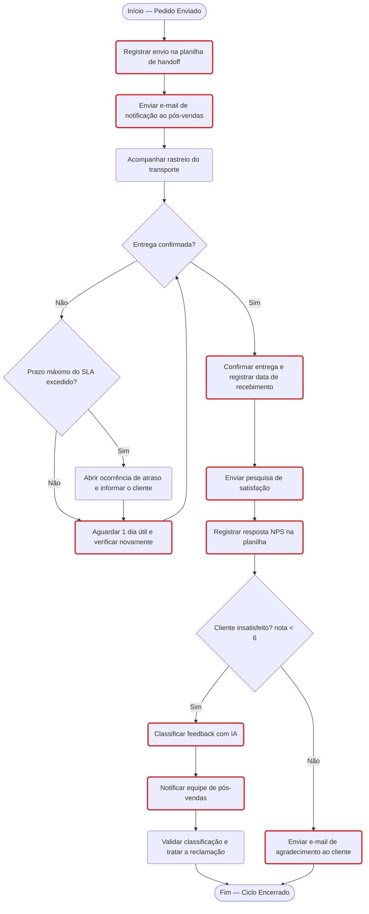

# Fluxograma do processo de pós-vendas (Hermex Log)

Versão em código (Mermaid) do fluxograma desenhado no Miro. O GitHub renderiza este diagrama automaticamente. As formas com **borda vermelha** são candidatas à automação.

| Atividade automatizável | Critérios |
|---|---|
| Registrar envio na planilha de handoff | Repetitividade, Transferência entre equipes, Rastreabilidade |
| Enviar e-mail de notificação ao pós-vendas | Repetitividade, Regras claras, Transferência entre equipes, Criticidade |
| Aguardar e verificar novamente (looping) | Repetitividade, Regras claras |
| Confirmar entrega | Regras claras, Rastreabilidade |
| Enviar pesquisa de satisfação | Repetitividade, Regras claras |
| Registrar resposta NPS | Repetitividade, Transferência entre equipes, Rastreabilidade |
| Classificar feedback com IA | Repetitividade, Regras claras, Criticidade |
| Notificar equipe de pós-vendas | Transferência entre equipes, Criticidade |
| Enviar agradecimento ao cliente | Repetitividade, Regras claras |
